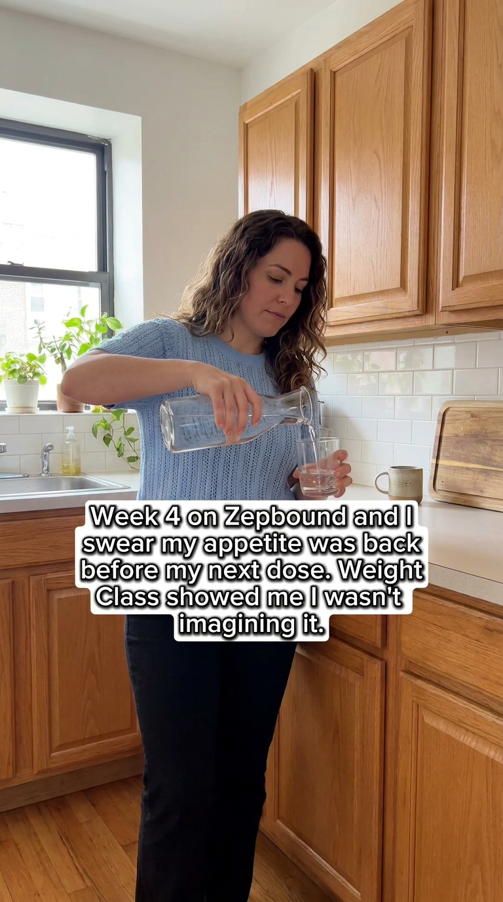
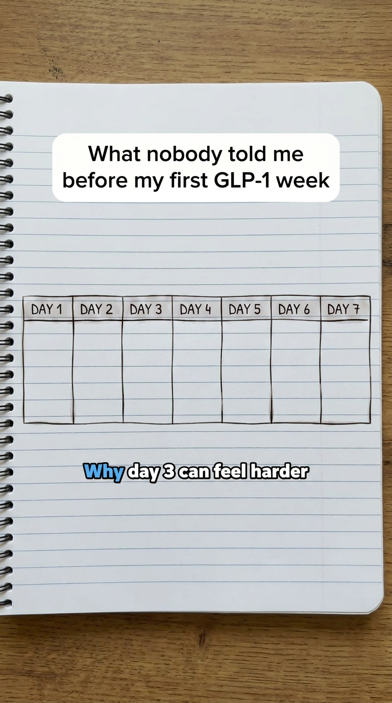
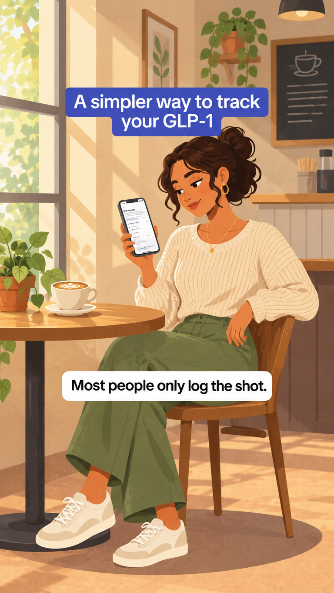

# Weight Class ads modeled on Shotsy's longest-running Meta ads

Made 2026-11-09 with Keepwatch, running locally.

**Each ad keeps from the original:** the story, the layout and the art style.

**What changed:**
- The location: a new setting with the same framing.
- The person: always a different one.
- The wording: our own words, not Shotsy's.

Every claim matches what Weight Class shows in its App Store screenshots: dose, pen and injection-site logging, how you feel, and food tracking.

None of the ads have an on-image button; Meta adds the CTA button under the ad.

## 1. My appetite was back before my next dose

- **Story (same as the original):** The medication wearing off before the next dose, proven by tracking
- **New location:** a bright, airy apartment kitchen with white tiles, light oak cabinets, a window with daylight and a few plants; a different woman stands at the counter pouring a glass of water, framed the same way
- **On-image text:** "Week 4 on Zepbound and I swear my appetite was back before my next dose. Weight Class showed me I wasn't imagining it."
- **Primary text:** Log your doses and how you feel each day, next to what you eat. Weight Class shows the pattern so you can bring it to your prescriber. Free GLP-1 mode.
- **Headline:** See your GLP-1 week in one place
- **Call to action (Meta button):** Download
- **Size:** Stories / Reels 9:16
- **Modeled on:** Shotsy, Meta ad 2364018821037292, live 98 days

## 2. I'm not guessing which side anymore

- **Story (same as the original):** Forgetting which injection site you used last
- **New location:** a wooden pier bench facing the ocean on an overcast morning, soft grey sky, calm sea, horizon at the same height as the reference; a different person sits alone on the bench seen from behind
- **On-image text:** "I kept forgetting which side I used last week. Now I don't have to." / "Weight Class logs my injection sites so I'm not guessing anymore."
- **Primary text:** Log each dose and where you injected it. Weight Class shows your recent sites so rotating is easy. Free GLP-1 mode.
- **Headline:** Remember every injection site
- **Call to action (Meta button):** Download
- **Size:** Stories / Reels 9:16
- **Modeled on:** Shotsy, Meta ad 1030601519974261, live 69 days

## 3. What nobody told me before my first GLP-1 week

- **Story (same as the original):** Why day 3 after a dose can feel harder
- **New location:** the same hand-drawn weekly calendar, but drawn on a page of a lined spiral notebook lying on a desk, seen straight from above
- **On-image text:** "What nobody told me before my first GLP-1 week" / "Why day 3 can feel harder"
- **Primary text:** How you feel can change across the week after each dose. Log your doses and how you feel in Weight Class and see your own pattern. This is not medical advice: talk to your prescriber.
- **Headline:** See your own GLP-1 week
- **Call to action (Meta button):** Download
- **Size:** Stories / Reels 9:16
- **Modeled on:** Shotsy, Meta ad 1823721282275104, live 38 days

## 4. Most people only log the shot

- **Story (same as the original):** Tracking more than just the shot
- **New location:** an illustrated cozy café corner with a round table, a coffee cup, a window with plants and warm light; a different illustrated character sits on a chair in the same pose
- **On-image text:** "A simpler way to track your GLP-1" / "Most people only log the shot."
- **Primary text:** Weight Class logs your doses, pens and sites, plus how you feel and what you eat, in one place. Free GLP-1 mode.
- **Headline:** Track more than the shot
- **Call to action (Meta button):** Download
- **Size:** Stories / Reels 9:16
- **Modeled on:** Shotsy, Meta ad 1439786271583712, live 38 days

## Before running these
- **Use real people for first-person captions.** Ads 1 and 2 speak in the first person, so run them with a real user or creator who says it, rather than as an anonymous testimonial.
- **Keep the prescriber framing.** Ad 3 makes a general health point ("day 3 can feel harder"), so its copy points to the prescriber. Keep that line in.
- **Make video versions.** Shotsy runs these as 6–10 second videos, and these are the opening frames.
- **Check Meta's rules for health and weight-loss ads.**
