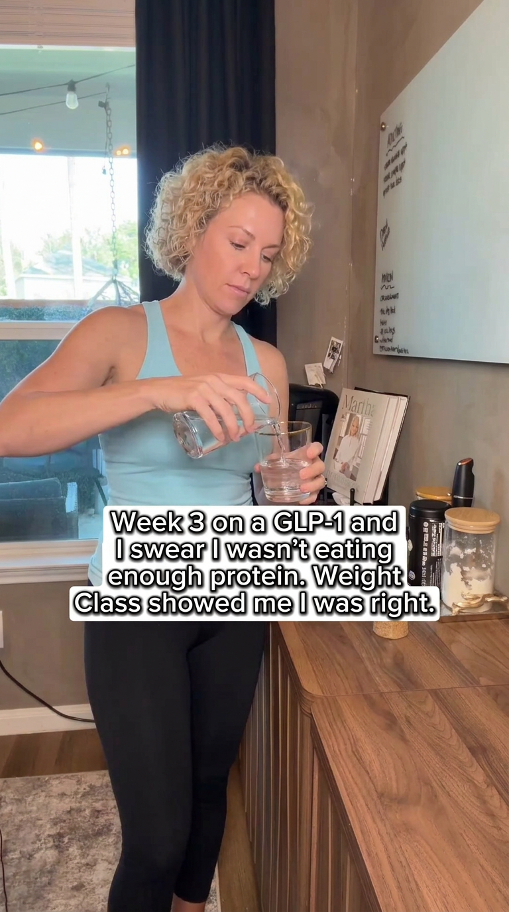
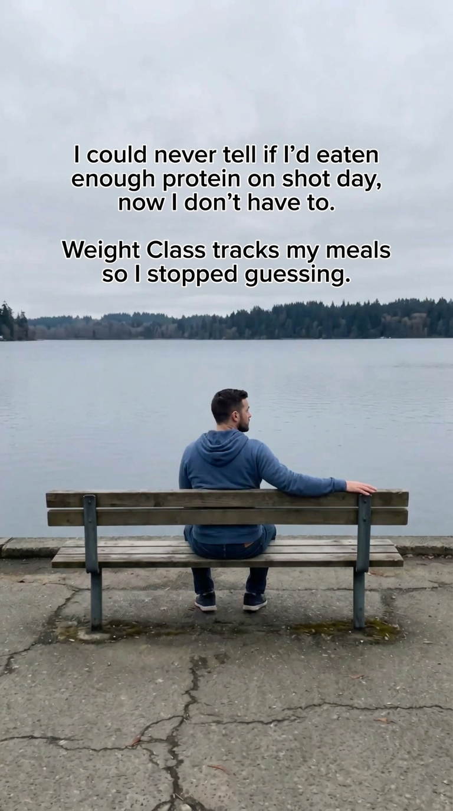
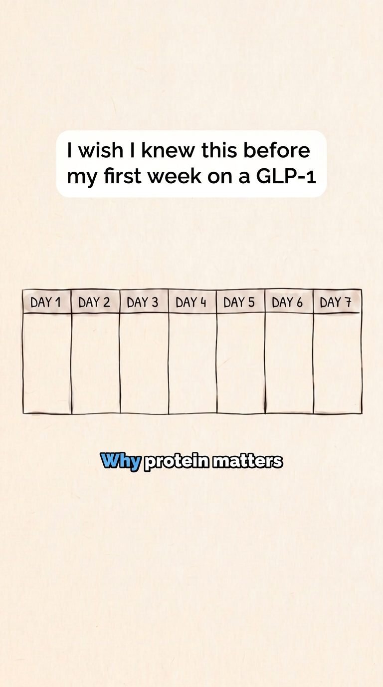
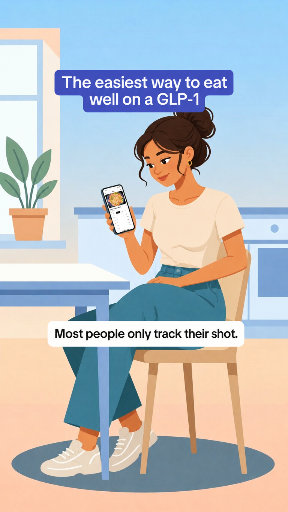

# Weight Class ads modeled on Shotsy's longest-running Meta ads

Made 2026-11-09 with Keepwatch, running locally.

**What changed from the original:** only the words, the person (always a different one), and the product where the original shows one.

**What stayed the same:** the layout, art style, caption boxes and fonts.

**What's left out:**
- No on-image buttons, because Meta adds the CTA button under the ad.
- No needles and no before-and-after bodies.

## 1. Week 3 on a GLP-1 and I wasn't eating enough protein

- **On-image text:** "Week 3 on a GLP-1 and I swear I wasn't eating enough protein. Weight Class showed me I was right."
- **Primary text:** Small appetite, same protein goal. Snap your plate and Weight Class shows calories, protein and fiber in seconds. Free GLP-1 mode.
- **Headline:** See if you're eating enough protein
- **Call to action (Meta button):** Download
- **Size:** Stories / Reels 9:16
- **Modeled on:** Shotsy, Meta ad 2364018821037292, live 98 days

## 2. I stopped guessing on shot day

- **On-image text:** "I could never tell if I'd eaten enough protein on shot day, now I don't have to." / "Weight Class tracks my meals so I stopped guessing."
- **Primary text:** Track meals, doses and injection sites in one app. Protein, fiber and water come first. Free to download.
- **Headline:** Stop guessing on shot day
- **Call to action (Meta button):** Download
- **Size:** Stories / Reels 9:16
- **Modeled on:** Shotsy, Meta ad 1030601519974261, live 69 days

## 3. I wish I knew this before my first week on a GLP-1

- **On-image text:** "I wish I knew this before my first week on a GLP-1" / "Why protein matters"
- **Primary text:** On a GLP-1 you eat less, so protein matters more. Weight Class shows protein, fiber and calories for every meal: snap, describe or scan.
- **Headline:** Protein first on a GLP-1
- **Call to action (Meta button):** Download
- **Size:** Stories / Reels 9:16
- **Modeled on:** Shotsy, Meta ad 1823721282275104, live 38 days

## 4. Most people only track their shot

- **On-image text:** "The easiest way to eat well on a GLP-1" / "Most people only track their shot."
- **Primary text:** Weight Class tracks your doses and your meals, with protein and fiber first. Snap, describe or scan. Free.
- **Headline:** Track what you eat, too
- **Call to action (Meta button):** Download
- **Size:** Stories / Reels 9:16
- **Modeled on:** Shotsy, Meta ad 1439786271583712, live 38 days

## Before running these
- **Shoot your own scenes.** Ads 1–3 recreate Shotsy's kitchen, lake bench and calendar graphic very closely. A format can't be owned, but their photos can. Re-shoot the same set-ups yourself, or ask Keepwatch for a different location, before spending on them.
- **Use real people for first-person captions.** Ads 1 and 2 speak in the first person, so run them with a real user or creator who says it, rather than as an anonymous testimonial.
- **Make video versions.** Shotsy runs these as short videos, and these are the opening frames. A 6–10 second video with the same caption is the closest match.
- **Check Meta's rules for health and weight-loss ads.**
