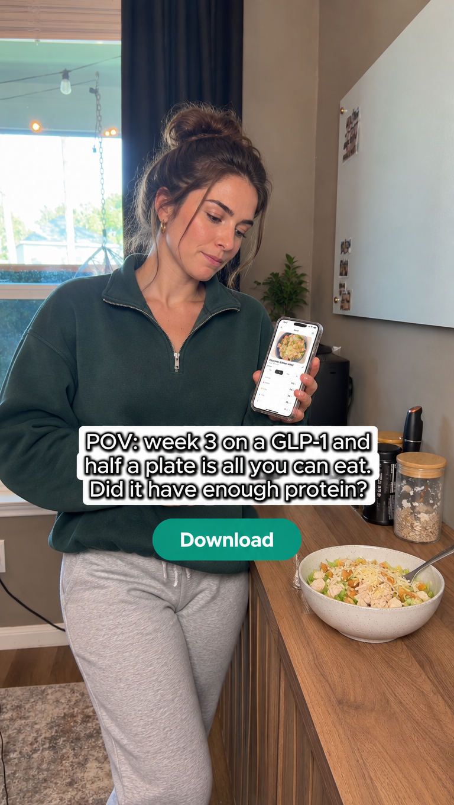
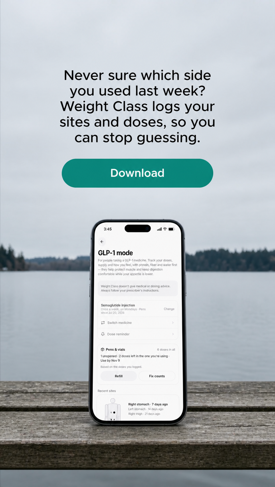
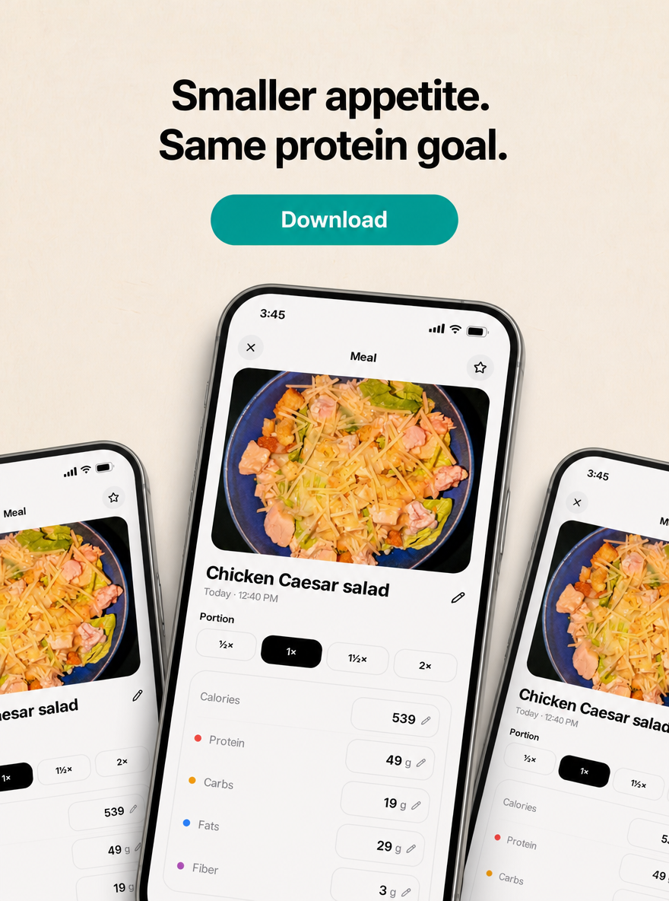
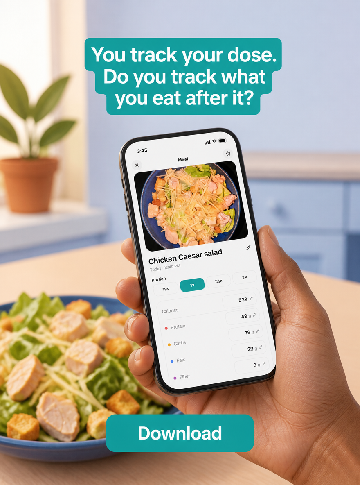

# Weight Class ads modeled on Shotsy's longest-running Meta ads

Made 2026-11-09 with Keepwatch, running locally. The images use the real App Store screenshots of Weight Class. Each ad keeps the reference ad's structure: notes-app caption, calm real-life setting, an education hook. None of Shotsy's wording, branding or people are reused.

## 1. POV: week 3 on a GLP-1 and half a plate is all you can eat. Did it have enough protein?

- **Size:** Stories / Reels 9:16
- **Primary text:** Small appetite, same protein goal. Snap your plate and Weight Class shows the calories, protein and fiber in seconds. Free to download, GLP-1 mode included.
- **Headline:** Snap your plate. See your protein.
- **Call to action:** Download
- **Why it should work:** Notes-app caption, Real-life moment, GLP-1 specific
- **Modeled on:** Meta ad 2364018821037292 (Shotsy, Ad Library)

## 2. Never sure which side you used last week? Weight Class logs your sites and doses, so you can stop guessing.

- **Size:** Stories / Reels 9:16
- **Primary text:** Track your GLP-1 doses, pens and injection sites next to your meals. Protein, fiber and water come first. Free GLP-1 mode.
- **Headline:** Your doses and meals in one app
- **Call to action:** Download
- **Why it should work:** Relatable worry, Calm setting, Tool fixes it
- **Modeled on:** Meta ad 1030601519974261 (Shotsy, Ad Library)

## 3. Smaller appetite. Same protein goal.

- **Size:** Feed 4:5
- **Primary text:** On a GLP-1 you eat less, so every bite counts more. Take a photo, describe your meal or scan a barcode, and Weight Class shows protein, fiber and calories you can check and edit.
- **Headline:** An estimate you can check
- **Call to action:** Download
- **Why it should work:** Education hook, Clear benefit, Product in frame
- **Modeled on:** Meta ad 1823721282275104 (Shotsy, Ad Library)

## 4. You track your dose. Do you track what you eat after it?

- **Size:** Feed 4:5
- **Primary text:** Most GLP-1 apps stop at the shot. Weight Class logs both: your doses and your meals, with protein and fiber first. Snap, describe or scan. Free.
- **Headline:** Doses and meals, one app
- **Call to action:** Download
- **Why it should work:** Contrast hook, Names the gap, Product in hand
- **Modeled on:** Meta ad 1439786271583712 (Shotsy, Ad Library)

**Before running these:**
- Check the copy against Meta's rules for health and weight-loss ads.
- Keep the "Weight Class doesn't give medical or dosing advice" line visible in the app.
